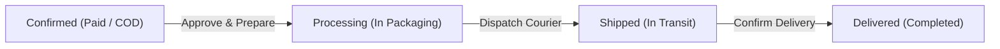

# FolioVerse — Seller Operations & Catalog Moderation Guide

**Document Version:** 1.0.0  
**Target Audience:** Book Sellers, Store Merchants & Fulfillment Staff  
**Author / Engineering Lead:** Bipronath Saha (bipronathsaha@gmail.com)

---

## 1. Executive Summary

The **FolioVerse Seller Operations & Fulfillment Portal** is a dedicated dashboard designed for verified merchants to observe incoming customer orders, verify customer contact and delivery credentials, monitor digital payment clearance (bKash, Nagad, Rocket, Card, COD), approve orders through fulfillment stages, and actively moderate book catalog inventory and pricing.

In compliance with clean role-based architecture:
- **No Buyer Dashboard Redirection**: Sellers log directly into the merchant interface without being redirected to buyer-specific views.
- **No Cart Clutter**: Shopping cart lists and checkout carts are omitted from the seller dashboard to keep the workspace focused on order fulfillment and catalog administration.

---

## 2. Seller Authentication & Access

### Demo Credentials
To access the Seller Portal during testing and evaluation:
- **Username:** `seller_demo`
- **Password:** `seller12345`
- **Role:** `Seller`

### Access Procedure
1. Navigate to the FolioVerse frontend (`http://localhost:5173/`).
2. Click **Sign In** in the top navigation bar.
3. Switch to the **Seller** persona or enter `seller_demo` / `seller12345`.
4. Once authenticated, the navigation bar displays the amber **Seller** badge with a store icon and a prominent **"Seller Dashboard"** button.
5. Click **"Seller Dashboard"** to open the full-screen Seller Operations Portal modal.

---

## 3. Seller Dashboard Architecture

The dashboard provides a top-level KPI analytics bar and two primary operational tabs:

### 3.1 Merchant KPI Analytics Bar
- **Sales Revenue:** Total gross revenue (in ৳ BDT) generated exclusively by the seller's books.
- **Units Sold:** Aggregate count of copies purchased by customers.
- **Needs Action (Pending):** Number of incoming orders awaiting seller review and shipment preparation.
- **Catalog Listings:** Total active book titles registered under the seller's profile.

---

## 4. Tab 1: Incoming Buyer Orders & Payment Verification

This tab allows sellers to observe who wants to buy their books and inspect complete order details.

### 4.1 What the Seller Observes
For each incoming order, the seller has full visibility into:
1. **Order Identifier & Timestamp**:
   - Order Reference (e.g., `FV-ORD-SELLER-101`).
   - Order placement date and time.
2. **Customer Identity & Contact Information**:
   - **Buyer Full Name**: Name of the customer placing the order.
   - **Username**: Registered account username (or guest buyer label).
   - **Phone Number**: Direct contact phone (e.g., `+880 1712-345678`) for delivery coordination.
   - **Email Address**: Customer email for notifications.
3. **Delivery Address**:
   - Complete destination street address, district, and shipping notes.
4. **Ordered Books Breakdown**:
   - Title and author of each book item belonging to this seller.
   - Unit price and quantity ordered.
   - Line subtotal.
5. **Payment Method & Clearance Status**:
   - **bKash Paid**: Paid via bKash mobile financial service with verified Transaction ID.
   - **Nagad Paid**: Paid via Nagad digital wallet with verified Transaction ID.
   - **Rocket Paid**: Paid via Dutch-Bangla Rocket with verified Transaction ID.
   - **Card Paid**: Paid via Stripe / Credit Card.
   - **Cash on Delivery (Pending)**: Doorstep cash handover required upon parcel delivery.

---

### 4.2 Order Approval & Fulfillment Workflow

Sellers have the authority to advance orders through fulfillment stages:

#### Step-by-Step Approval Actions:
1. **Approve Order**:
   - When an order is in `confirmed` status, click **"Approve & Prepare Shipment"**.
   - The backend transitions the order status to `processing`.
2. **Dispatch Parcel**:
   - Once the book package is handed to the courier, click **"Dispatch with Courier"**.
   - The order status advances to `shipped`.
3. **Confirm Delivery**:
   - Upon customer receipt, click **"Confirm Delivery"**.
   - The order status becomes `delivered`, successfully completing the cycle.

---

## 5. Tab 2: Catalog Management & Price Moderation

The second tab gives sellers complete control over their published book catalog.

### 5.1 Inline Price Moderation
Sellers can moderate book prices without leaving the dashboard:
1. Locate the book row in the catalog table.
2. Click the **Edit Price** (pencil) icon next to the current price.
3. Enter the revised price in BDT.
4. **Validation Constraint**:
   - The price must be a valid number and meet the minimum catalog price rule ($\ge \text{৳180.00}$).
   - Attempting to set a price below ৳180 will display an alert and prevent saving.
5. Click the green checkmark ($\checkmark$) to save. The update is atomically dispatched to `PATCH /api/books/<id>/` and the row reflects the updated price immediately.

### 5.2 Stock Inventory Control
- Click the **`+`** button to quickly restock 5 additional units.
- Click the **`-`** button to decrement stock.
- The UI automatically updates availability tags:
  - **In Stock** ($\ge 4$ copies): Emerald badge.
  - **Low Stock** ($1 - 3$ copies): Amber badge with warning.
  - **Out of Stock** ($0$ copies): Rose badge; book cannot be purchased by buyers until restocked.

### 5.3 Adding New Books to the Catalog
1. Click the **"List New Book"** button in the dashboard header.
2. Complete the listing form:
   - **Title & Author**: Book title and creator name.
   - **Category & Subcategory**: Select from Science, Technology, Fiction, Literature & Novel (Bengali / English), or Music.
   - **Price**: Selling price in BDT.
   - **Initial Stock**: Available copies in inventory.
   - **Condition**: Brand New, Used - Like New, Used - Good, Used - Fair.
   - **Language & ISBN**: Language specification and publication identifier.
   - **Cover Image URL**: Valid image URL for cover display.
   - **Description**: Synopsis or synopsis notes.
3. Submit the listing: the new book is instantly added to the database with `seller=request.user`.

### 5.4 Delisting Titles
- Click the **Delete** (trash) icon on any book row to permanently delist it from the store catalog.

---

## 6. Backend API Reference for Sellers

| Endpoint | Method | Permission | Payload / Response |
| :--- | :---: | :---: | :--- |
| `/api/orders/seller-summary/` | `GET` | Authenticated (Seller / Admin) | Returns seller's sales metrics, book counts, and list of incoming customer orders. |
| `/api/orders/<id>/update-status/` | `POST` / `PATCH` | Authenticated (Seller / Admin) | `{ "status": "processing" \| "shipped" \| "delivered" }` |
| `/api/books/?seller=me` | `GET` | Authenticated | Filters catalog to only display the logged-in seller's books. |
| `/api/books/<id>/` | `PATCH` | Authenticated (Owner / Admin) | `{ "price": "299.00", "stock": 15 }` |
| `/api/books/<id>/` | `DELETE` | Authenticated (Owner / Admin) | Removes book record from the catalog. |

---

## 7. Security & Role Isolation Verification

1. **Authentication Enforcement**: Unauthenticated callers cannot access `/api/orders/seller-summary/` or update order statuses (HTTP 401 Unauthorized).
2. **Item Ownership Scoping**: The seller summary endpoint filters `OrderItem` records where `book__seller=request.user`, guaranteeing that a seller only sees line items and revenues from books they own.
3. **Database Integrity**: All status transitions and inventory adjustments are guarded by PostgreSQL transactional checks and validations.
