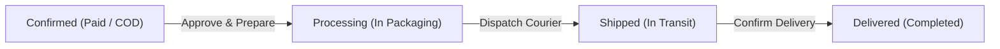

# FolioVerse — Seller Operations & Catalog Moderation Guide

**Document Version:** 2.0.0  
**Target Audience:** Book Sellers, Store Merchants & Fulfillment Staff  
**Author / Engineering Lead:** Bipronath Saha (bipronathsaha@gmail.com)

---

## 1. Executive Summary

The **FolioVerse Seller Operations & Fulfillment Portal** is a dedicated dashboard designed for verified merchants to observe incoming customer orders, verify customer contact and delivery credentials, monitor digital payment clearance (bKash, Nagad, Rocket, Card, COD), approve orders through fulfillment stages, and actively moderate book catalog inventory and pricing.

In compliance with clean role-based architecture:
- **No Buyer Dashboard Redirection**: Sellers log directly into the merchant interface without being redirected to buyer-specific views.
- **No Cart Clutter**: Shopping cart lists and checkout carts are omitted from the seller dashboard to keep the workspace focused on order fulfillment and catalog administration.
- **Unified Catalog Attribution**: Catalog books are fully integrated into the merchant dashboard so purchases are immediately visible to the seller.

---

## 2. Seller Authentication & Access

### Demo Credentials
To access the Seller Portal during testing and evaluation:
- **Username:** `seller_demo`
- **Password:** `seller12345`
- **Role:** `Book Seller` (`seller`)

### Access Procedure
1. Navigate to the FolioVerse storefront (`https://folioverse.vercel.app/` or `http://localhost:5173/`).
2. Click **Login** in the top navigation bar.
3. Click the **"1-Click Seller Login"** button (or enter `seller_demo` / `seller12345`).
4. Once authenticated, the navigation bar displays the amber **Seller** badge with a store icon and a prominent **"Seller Portal"** button.
5. On mobile devices, tap the hamburger menu to open the mobile drawer and tap **"Seller Portal"**.

---

## 3. Seller Dashboard Architecture

The dashboard provides a top-level KPI analytics bar and two primary operational tabs:

### 3.1 Merchant KPI Analytics Bar
- **Sales Revenue:** Total gross revenue (in ৳ BDT) generated exclusively by the seller's books.
- **Units Sold:** Aggregate count of copies purchased by customers.
- **Needs Action (Pending):** Number of incoming orders awaiting seller review and shipment preparation.
- **Catalog Listings:** Total active book titles registered under the seller's profile.

---

## 4. Tab 1: Incoming Buyer Orders & Payment Verification

This tab allows sellers to observe who wants to buy their books and inspect complete order details in real time.

### 4.1 What the Seller Observes
For each incoming order, the seller has full visibility into:
1. **Order Identifier & Timestamp**:
   - Order Reference (e.g., `FV-ORD-1792936212-2326`).
   - Order placement date and time.
2. **Customer Identity & Contact Information**:
   - **Buyer Full Name**: Name of the customer placing the order.
   - **Username**: Registered account username (or direct buyer indicator).
   - **Phone Number**: Direct contact phone (e.g., `01711223344`) for courier delivery coordination.
   - **Email Address**: Customer email for notifications.
3. **Delivery Address**:
   - Complete destination street address, district, and shipping notes.
4. **Ordered Books Breakdown**:
   - Title, author, and cover image of each book item belonging to this seller.
   - Unit price and quantity ordered.
   - Line subtotal.
5. **Payment Method & Clearance Status**:
   - **bKash Paid**: Paid via bKash mobile financial service with verified Transaction ID.
   - **Nagad Paid**: Paid via Nagad digital wallet with verified Transaction ID.
   - **Rocket Paid**: Paid via Dutch-Bangla Rocket with verified Transaction ID.
   - **Cash on Delivery (Pending)**: Doorstep cash handover required upon parcel delivery.

---

### 4.2 Order Approval & Fulfillment Workflow

Sellers have the authority to advance orders through fulfillment stages:

#### Step-by-Step Approval Actions:
1. **Approve Order**:
   - When an order is in `confirmed` status, click **"Approve & Prepare Shipment"**.
   - The backend transitions the order status to `processing`.
2. **Dispatch Parcel**:
   - Once the book package is handed to the courier, click **"Dispatch with Courier"**.
   - The order status advances to `shipped`.
3. **Confirm Delivery**:
   - Upon customer receipt, click **"Confirm Delivery"**.
   - The order status becomes `delivered`, successfully completing the cycle and marking COD payments as cleared.

---

## 5. Tab 2: Catalog Management & Moderation

### 5.1 Inline Price Editing
- Sellers can edit the price of any listed book directly from the table.
- **Enterprise Price Floor**: The system strictly validates prices to ensure they cannot be set below **৳180.00**, protecting merchant margins and preventing accidental pricing errors.

### 5.2 Stock Inventory Controls
- Instant increment/decrement buttons allow fast stock adjustments.
- Color-coded stock badges:
  - Green (`Available`): $\ge 4$ units.
  - Amber (`Low Stock`): $1-3$ units remaining.
  - Red (`Sold Out`): $0$ units left.
