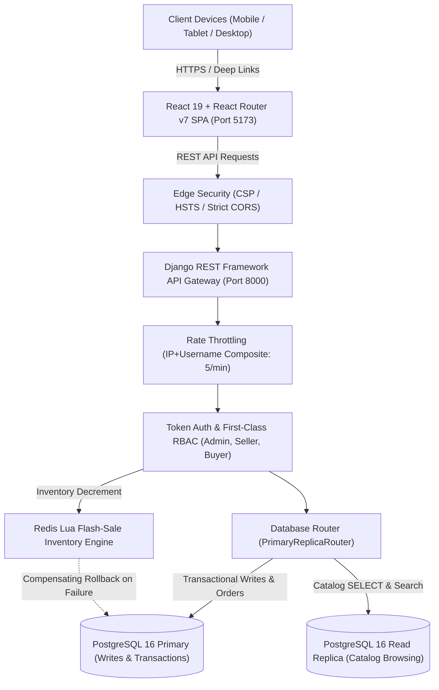
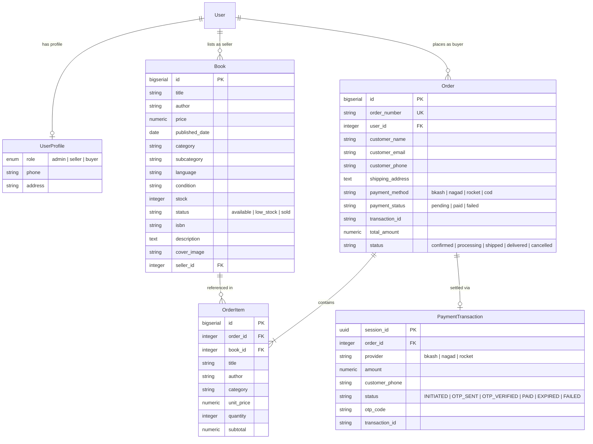

# FolioVerse — System Architecture & Scalability Document

**Document Version:** 2.0.0  
**Status:** Enterprise System Architecture Specification  
**Authority / Owner:** Bipronath Saha (bipronathsaha@gmail.com)

---

## 1. High-Level Architecture Overview

FolioVerse is constructed using a decoupled, defense-in-depth, highly scalable architecture:
- **Client Presentation Layer:** Single Page Application (SPA) built with React 19, React Router v7, Vite 8, and Tailwind CSS v4, supporting deep linking (`/books/:id`, `/cart`, `/checkout`) and responsive layouts from mobile to wide screens.
- **Edge & Transport Security:** Strict CORS allowed origins, SecurityHeadersMiddleware (CSP, HSTS 1-year, X-Frame-Options DENY, nosniff, Permissions-Policy).
- **API Gateway & Throttling:** Django 5.2 and Django REST Framework (DRF) running WSGI/ASGI services with composite IP+Username rate throttles.
- **First-Class RBAC & Zero-Trust:** Database-backed role enum (`admin`, `seller`, `buyer`), eliminating client-side guessing and preventing IDOR tampering (`IsOwnerOrReadOnly`, `IsOrderParticipantOrAdmin`).
- **High-Concurrency Caching & Flash-Sale Engine:** Redis in-memory store utilizing atomic Lua scripts to handle inventory decrements for 100k+ concurrent shoppers with compensating rollbacks.
- **Data Layer with Read/Write Splitting:** PostgreSQL 16 (Neon Serverless) with multi-column composite B-Tree indexes, row-level locking (`select_for_update`), and database routing (`PrimaryReplicaRouter`) directing catalog queries to read replicas.

---

## 2. Technology Stack & Enterprise Standards

| Layer | Technology | Version | Purpose |
| :--- | :--- | :--- | :--- |
| **Frontend Framework** | React | 19.x | Component lifecycle & UI state management |
| **Client Routing** | React Router | 7.x | Deep-linkable routing (`/books/:id`, `/cart`, `/checkout`) |
| **Build Tooling** | Vite | 8.3.x | Lightning-fast HMR dev server & production bundling |
| **Styling** | Tailwind CSS & CSS3 | 4.x | Modern utility styling & glassmorphism tokens |
| **Icons** | Lucide React | Latest | High-fidelity, accessible iconography |
| **HTTP Client** | Axios | 1.7.x | Interceptors for token auth and unified error handling |
| **Backend Framework** | Django | 5.2.x | Core web framework, ORM, and migration engine |
| **API Framework** | Django REST Framework | 3.16.x | ModelViewSets, serializers, pagination, throttling |
| **In-Memory Cache & Lua** | Redis | 7.x+ | Flash-sale stock reservation & cache acceleration |
| **Database Engine** | PostgreSQL (Neon) | 16.x | ACID transactional storage with connection pooling |
| **Database Router** | PrimaryReplicaRouter | Custom | Read/write splitting for horizontal read scaling |
| **Python Runtime** | Python | 3.11+ | Production-grade runtime environment |

---

## 3. High-Concurrency Flash-Sale Scaling (100k+ Active Shoppers)

Traditional database updates under extreme concurrent shopping traffic cause database connection pool exhaustion and transaction lock timeouts. FolioVerse solves this with a **Two-Phase Reservation Pattern**:

### Phase 1: Redis Lua Stock Reservation
When a shopper places an order or clicks "Buy Now":
1. The backend executes an atomic Lua script in Redis.
2. If remaining stock $\ge \text{quantity}$, stock is instantly decremented in memory and the operation succeeds in $<1\text{ms}$.
3. If stock is insufficient, the request is immediately rejected with HTTP 400 without placing any load on PostgreSQL.

### Phase 2: PostgreSQL Persistence
1. Inside a PostgreSQL atomic transaction (`transaction.atomic()`):
   - The book's stock is decremented in PostgreSQL.
   - An `Order` record and corresponding `OrderItem` records are created.
   - The user and payment method are recorded.
2. **Compensating Rollback Guarantee**: If the database transaction fails (e.g. timeout or connection drop), the exception handler calls `RedisInventoryManager.rollback_stock(book_id, qty)` to immediately restore the reserved stock in Redis.

---

## 4. Database Schema & Entity Relationships

---

## 5. Security & Defense-in-Depth Specification

1. **Layer 1: Network & Edge Security**:
   - CSP header: `default-src 'self'`.
   - Clickjacking prevention: `X-Frame-Options: DENY`.
   - MIME sniffing protection: `X-Content-Type-Options: nosniff`.
   - Transport security: Strict HTTPS redirection and 1-year HSTS header.
2. **Layer 2: API Gateway Throttling**:
   - `LoginCompositeRateThrottle`: Combines IP and Username (`f"{ip}:{username}"`) to restrict login attempts to `5/minute`.
   - `AuthAnonRateThrottle`: Limits user registration to `10/minute`.
3. **Layer 3: Zero-Trust Access Control**:
   - `IsOwnerOrReadOnly`: Books can only be modified or deleted by their verified owner or store admin.
   - `IsOrderParticipantOrAdmin`: Order lists and receipts are strictly scoped to the purchasing buyer or selling merchant.
4. **Layer 4: CI/CD Automated Vulnerability Scanning**:
   - GitHub Actions workflow (`security-audit.yml`) runs `pip-audit`, `bandit` SAST, `check --deploy`, and `npm audit`.
