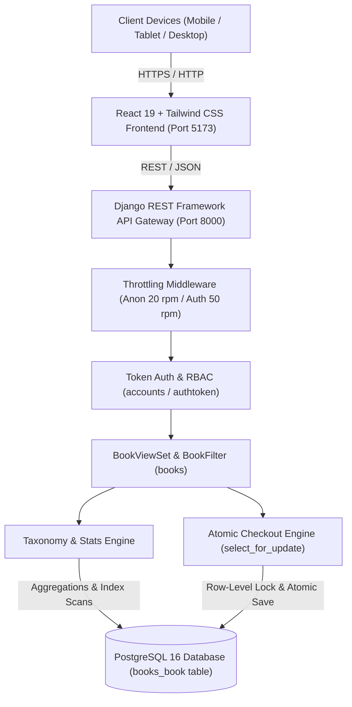

# FolioVerse — System Architecture Document

**Document Version:** 1.0.0  
**Status:** Architecture Specification  
**Authority / Owner:** Bipronath Saha (bipronathsaha@gmail.com)

---

## 1. High-Level Architecture Overview

FolioVerse is constructed using a decoupled client-server architecture:
- **Frontend Layer:** Single Page Application (SPA) built with React 19, Vite 8, Tailwind CSS, and custom glassmorphism design tokens.
- **API & Application Layer:** Django 5.2 and Django REST Framework (DRF) running WSGI/ASGI services.
- **Persistence Layer:** PostgreSQL 16 relational database with multi-column composite B-Tree indexes and SQL CHECK constraints.
- **Authentication & Security Layer:** DRF Token Authentication, Role-Based Access Control (RBAC), and IP/User rate throttles.



---

## 2. Technology Stack

| Layer | Technology | Version | Purpose |
| :--- | :--- | :--- | :--- |
| **Frontend Runtime** | React | 19.x | Component lifecycle & UI state rendering |
| **Build Tooling** | Vite | 8.3.x | Fast HMR dev server & optimized production rollup |
| **Styling** | Tailwind CSS & CSS3 | 3.4.x | Utility styling, flexbox/grid layout, glassmorphism |
| **Icons** | Lucide React | Latest | High-fidelity responsive iconography |
| **HTTP Client** | Axios | 1.7.x | Interceptors for token auth and unified error handling |
| **Backend Framework** | Django | 5.2.x | Core web framework, ORM, and migration engine |
| **API Framework** | Django REST Framework | 3.16.x | ModelViewSets, serializers, pagination, throttling |
| **Filtering Engine** | django-filter | 25.x | Declarative query parameter filtering |
| **Database** | PostgreSQL | 16.x | ACID transactional storage with row locks |
| **Python Runtime** | Python (Virtual Environment) | 3.12+ | Isolated dependencies via `backend/venv` |

---

## 3. Database Schema & Data Modeling

### 3.1 The `books_book` Entity Schema

```sql
CREATE TABLE books_book (
    id BIGSERIAL PRIMARY KEY,
    title VARCHAR(255) NOT NULL,
    author VARCHAR(255) NOT NULL,
    price NUMERIC(10, 2) NOT NULL,
    published_date DATE NOT NULL,
    category VARCHAR(100) NOT NULL DEFAULT 'Literature & Novel',
    subcategory VARCHAR(100) NOT NULL DEFAULT 'English Literature',
    language VARCHAR(50) NOT NULL DEFAULT 'English',
    condition VARCHAR(50) NOT NULL DEFAULT 'New',
    stock INTEGER NOT NULL DEFAULT 10,
    status VARCHAR(20) NOT NULL DEFAULT 'available',
    isbn VARCHAR(30) NOT NULL DEFAULT '',
    description TEXT NOT NULL DEFAULT '',
    cover_image VARCHAR(500) NOT NULL DEFAULT '',
    seller_id INTEGER REFERENCES auth_user(id) ON DELETE SET NULL,
    created_at TIMESTAMP WITH TIME ZONE NOT NULL DEFAULT CURRENT_TIMESTAMP,
    updated_at TIMESTAMP WITH TIME ZONE NOT NULL DEFAULT CURRENT_TIMESTAMP,
    CONSTRAINT book_price_non_negative CHECK (price >= 0),
    CONSTRAINT book_stock_non_negative CHECK (stock >= 0)
);
```

### 3.2 Indexing Strategy for 2,000+ Books
To guarantee instant pagination, filtering, and sub-15ms live searches across 2,000+ records, five composite B-Tree indexes are deployed:
1. `CREATE INDEX books_category_subcategory_idx ON books_book (category, subcategory);`
2. `CREATE INDEX books_status_stock_idx ON books_book (status, stock);`
3. `CREATE INDEX books_author_title_idx ON books_book (author, title);`
4. `CREATE INDEX books_price_idx ON books_book (price);`
5. `CREATE INDEX books_language_idx ON books_book (language);`

---

## 4. ACID Concurrency & Zero-Overselling Implementation

During flash sales or concurrent buyer checkout on low-stock books, standard read-modify-write patterns cause race conditions leading to negative inventory.

### 4.1 Implementation: `select_for_update()` in `BookViewSet.buy()`
```python
@action(detail=True, methods=['post'], permission_classes=[permissions.AllowAny])
def buy(self, request, pk=None):
    quantity = int(request.data.get('quantity', 1))
    if quantity <= 0:
        return Response({"error": "Quantity must be >= 1."}, status=status.HTTP_400_BAD_REQUEST)

    with transaction.atomic():
        try:
            # Acquires PostgreSQL row-level lock (FOR UPDATE)
            book = Book.objects.select_for_update().get(pk=pk)
        except Book.DoesNotExist:
            return Response({"error": "Book not found."}, status=status.HTTP_404_NOT_FOUND)

        if book.stock < quantity:
            return Response(
                {"error": f"Insufficient stock. Only {book.stock} left for '{book.title}'."},
                status=status.HTTP_400_BAD_REQUEST
            )

        # Concurrency-safe decrement
        book.stock -= quantity
        book.save()  # Auto-triggers status recalculation ('available', 'low_stock', 'sold')

        total = float(book.price) * quantity
        return Response({"message": "Order confirmed", "order": {...}}, status=status.HTTP_200_OK)
```

---

## 5. Security & Rate Throttling

### 5.1 Token Authentication & Header
Every authenticated request includes:
```http
Authorization: Token <40-character-hex-token>
```
The frontend Axios interceptor automatically attaches this token from `localStorage('folioverse_token')`.

### 5.2 Rate Limiting
Configured in `settings.py`:
- **Anonymous Clients:** `20 requests / minute` (enforced by `AnonRateThrottle`).
- **Authenticated Clients:** `50 requests / minute` (enforced by `UserRateThrottle`).
- When a user exceeds the limit, the server returns `HTTP 429 Too Many Requests`, and the frontend captures this in a non-intrusive warning toast notification.

---

## 6. Authority Routing Architecture (`bipronathsaha@gmail.com`)

The contact system uses a dual-layer approach:
1. **Client-Side URI Protocol Handler:** Form inputs are sanitized and translated into an RFC 2368 compliant `mailto:` URI pointing directly to `bipronathsaha@gmail.com`.
2. **Redirection & State Confirmation:** Triggers OS email client handoff (`window.location.href`) while rendering a visual in-app confirmation modal verifying delivery to the platform authority.
